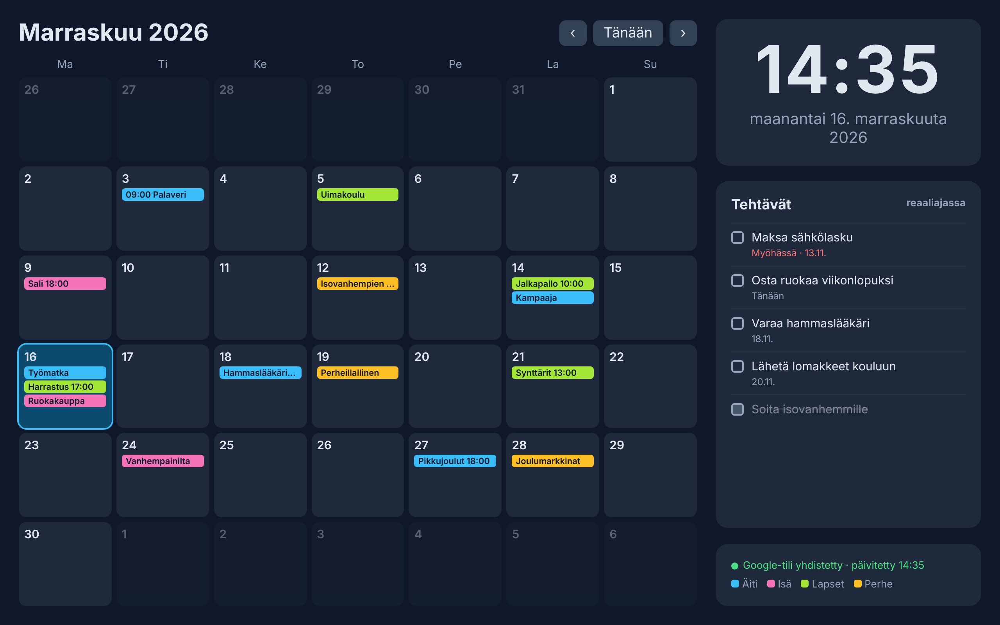
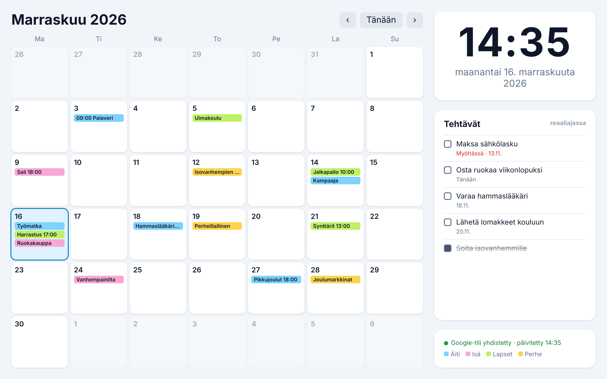

# kotinaytto

Moduulinen kotinäyttö, josta näkee perheen menot suoraan.

## Mockup

### Tumma teema

### Vaalea teema

Kuvat ovat havainnollistavia luonnoksia, ei sitova ulkoasu. Tapahtumat ja tehtävät ovat esimerkkejä.

## Vaatimusmäärittely

### 1. Kalenterinäkymä

- ✅ **V1.1** Sovellus näyttää kalenterin kuukausinäkymänä (yksi kuukausi kerrallaan).
- ✅ **V1.2** Käyttäjä voi selata edelliseen ja seuraavaan kuukauteen sekä palata kuluvaan kuukauteen.
- **V1.3** Kuluva päivä on korostettu näkymässä.
- **V1.4** Kunkin päivän tapahtumat (menot) näkyvät päivän kohdalla kuukausinäkymässä.
- **V1.5** Kalenteriin voi yhdistää Gmail- eli Google-tilin (Google Calendar) kirjautumalla tilille Googlen OAuth 2.0 -valtuutuksella. Sovellus pyytää vain kalenterin lukuoikeuden.
- **V1.6** Yhdistetty tili säilyy, eikä käyttäjän tarvitse kirjautua uudelleen joka käynnistyksellä. Tilin yhteyden voi myös katkaista.
- **V1.7** Tuki useammalle kalenterille (esim. perheenjäsenten kalenterit) on toivottavaa; niiden tapahtumat erotetaan toisistaan värein.

### 2. Kellonaika

- **V2.1** Kellonaika on jatkuvasti näkyvissä näytöllä.
- **V2.2** Kello päivittyy vähintään minuutin välein (suositus: sekunnin välein) ilman käyttäjän toimia.
- **V2.3** Kellonaika esitetään 24 tunnin muodossa Suomen aikavyöhykkeellä (Europe/Helsinki), ja kesäaikaan siirtyminen huomioidaan automaattisesti. Päivämäärä ja viikonpäivä näytetään suomeksi.

### 3. Tehtävät

- **V3.1** Jos Google-kalenterissa tai Google Tasks -tehtävälistassa on tehtäviä, ne listataan näytölle.
- **V3.2** Tehtävälista päivittyy reaaliajassa: uusi, muuttunut tai poistettu tehtävä näkyy näytöllä ilman, että sivua tarvitsee ladata uudelleen.
- **V3.3** Tehtävästä näytetään vähintään otsikko ja eräpäivä. Tehtävät järjestetään eräpäivän mukaan, ja myöhässä olevat merkitään selvästi.
- **V3.4** Suoritetuksi merkityt tehtävät poistuvat listalta tai erottuvat selvästi.

### 4. Synkronointi puhelimista

- **V4.1** Kun Google-kalenteria päivitetään omalla puhelimella (tapahtuman lisäys, muokkaus tai poisto), muutos päivittyy kotinäytölle automaattisesti.
- **V4.2** Päivitys näkyy näytöllä mahdollisimman nopeasti, tavoitteena enintään 1 minuutti muutoksesta.
- **V4.3** Toteutus perustuu Google Calendar API:in: ensisijaisesti push-ilmoituksiin (watch/webhook) ja varamekanismina säännölliseen kyselyyn (polling) esim. minuutin välein, sekä inkrementaaliseen synkronointiin (`syncToken`).
- **V4.4** Verkkoyhteyden katkettua sovellus näyttää viimeksi haetut tiedot ja ilmoittaa, ettei tieto ole ajan tasalla. Yhteyden palautuessa tiedot synkronoituvat automaattisesti.
- **V4.5** Muutokset tehdään vain Google-kalenterissa (puhelimella); kotinäyttö on ensisijaisesti lukunäkymä.

### 5. Ei-toiminnalliset vaatimukset

- **V5.1** Käyttöliittymä on suunniteltu kotiseinälle tai pöydälle sijoitettavalle näytölle: selkeä ja luettava etäältä, mukautuu eri näyttökokoihin ja toimii kokoruututilassa.
- **V5.2** Sovellus käynnistyy ja toimii itsenäisesti ilman jatkuvaa ylläpitoa.
- **V5.3** Kirjautumistunnisteet (OAuth-tokenit) tallennetaan turvallisesti, eikä niitä tallenneta versionhallintaan.
- **V5.4** Käyttöliittymän kieli on suomi.
- **V5.5** Arkkitehtuuri on moduulinen, jotta uusia näkymiä (esim. sää, ruokalista) voidaan lisätä myöhemmin.

### 6. Rajaukset (ei kuulu ensimmäiseen versioon)

- Tapahtumien muokkaaminen suoraan kotinäytöltä.
- Muut kalenteripalvelut kuin Google Calendar.
